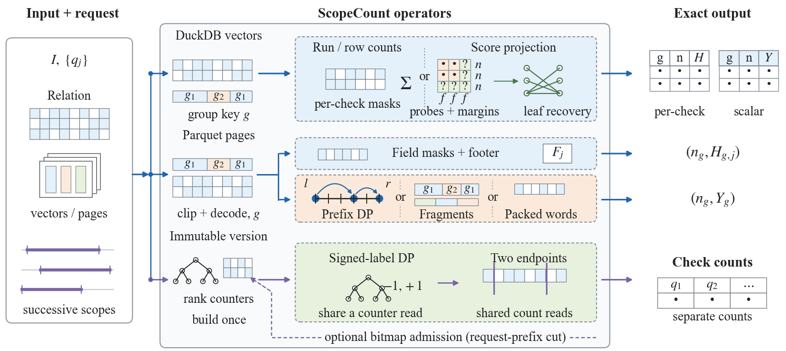
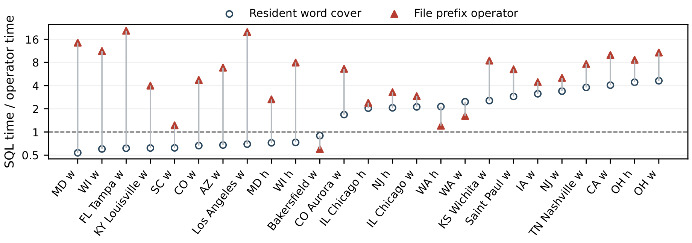

# ScopeCount

A DuckDB implementation of *Exact Grouped Completeness Audits from Score Margins and Boundary Prefixes*, with resident, projected-file, and retained-interval operators.



### Run an audit

On x64 Windows with Visual Studio C++ Build Tools and Python 3.13:

```powershell
python -m pip install -r requirements.txt
python reproduce.py build
python reproduce.py fetch --names ca_bakersfield
python reproduce.py quick
python reproduce.py summarize --frozen --out outputs/published
```

The quick run checks exact answers on complete SQLShare and FCC inputs, one reconstructed traffic-stop source, and selected transport/validator snapshots, plus kernel/model regressions. [Reproduction](docs/reproduce.md) · [Experiment map](docs/experiments.md) · [Data](docs/data.md) · [Validation](docs/validation.md)

### Audit results



Over ten rounds on 25 weekly/hourly traffic-stop queries, ScopeCount's per-query medians sum to **3.32 s**. Choosing the fastest SQL, dense-rank, CRoaring, or packed-score reference separately for each query gives **4.09 s**. ScopeCount beats SQL on 24 of 25 queries. The frozen summary recomputes these totals from [original trials](research/artifact/pageaudit/results/confirm/trials.tsv). Timing repetitions measure variability; they do not enlarge the observed request horizon.
