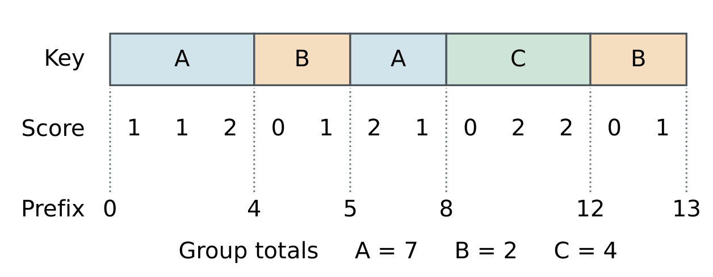
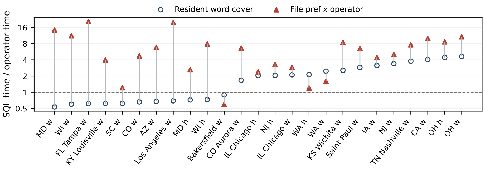

# ScopeCount

Exact grouped completeness audits from score margins and boundary prefixes.

ScopeCount reads Parquet validity information through DuckDB. Known group sizes and boundary prefixes recover the number of missing fields for each group.

**Weekly and hourly traffic-stop audits**

In a separate ten-round comparison, the file prefix operator won **24 of 25** queries. Its per-query medians summed to **3.32 s**, versus **4.09 s** when choosing the fastest of SQL, dense rank, CRoaring and packed row scores separately for each query.

Load the extension and check six plans against grouped SQL on x64 Windows with Python 3.11–3.13 and Visual Studio C++ Build Tools:

~~~powershell
python -m pip install -r requirements.txt
python build.py
python run_example.py
~~~
